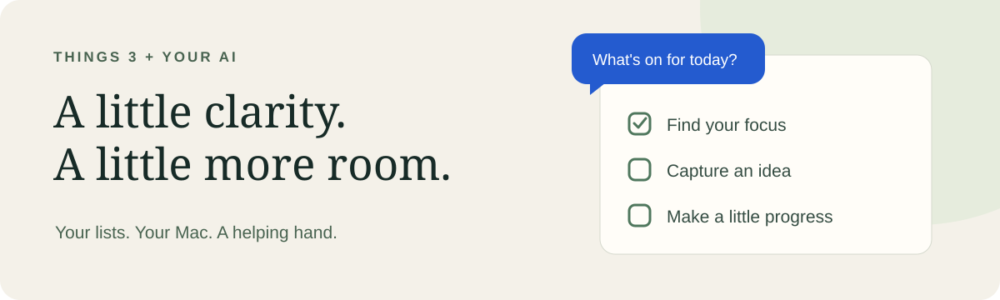

# A little help with everything on your list.

Find the task you forgot. Turn a rough idea into a project. Make room for what matters today.

**Things 3 MCP connects your AI app to Things on your Mac.** MCP is the connection that lets an AI app use other tools. You don't need to write code to use it.

| Start with a question | Add more when you're ready |
| --- | --- |
| “What's on my list today?” | “Add a task to book the appointment.” |
| “Find my notes about the trip.” | “Plan a project for the move.” |
| “What deadlines are coming up?” | “Move this task into my weekend project.” |

**macOS** · **Things 3** · **Read-only setup first** · **MIT licensed**

> **2.0 private preview.** Setup installs candidate `6370089`, rather than the older public package. Access to the private repository is required.

## Choose your setup

| ✦ Let an agent help | ↗ Set it up yourself |
| --- | --- |
| Give a coding agent the prompt below. It checks your Mac, installs the tool, and configures your chosen app. | Follow four steps with copyable commands and settings. |
| [Copy the setup prompt ↓](#set-it-up-with-an-agent) | [Open the manual guide →](docs/SETUP.md) |

**You'll need:** a Mac with Things 3 opened at least once, and an AI app that supports local MCP servers. Agent-assisted setup needs a coding agent with access to your Mac; a chat window alone may not be able to install software.

## Set it up with an agent

Copy the whole block into your coding agent. It will ask which AI app you want to connect.

```text
Help me connect Things 3 to my AI app on this Mac.

Read this setup guide first:
https://github.com/Chevalicious/mcp-things/blob/preview/2.0/SETUP-AGENT.md

This is the private 2.0 preview. Use candidate revision:
637008919cebb3b74954a502d1071b2c2864197a
from https://github.com/Chevalicious/mcp-things.git
If you cannot access the guide or repository, explain what access is missing.

Ask which AI app I want to connect. Check for an existing installation
and preserve its settings. Install the candidate only if needed.
Configure local stdio with read-only access and verify a harmless read.
Don't start a duplicate service, change my tasks, or expose a network port.
Keep credentials out of chat and source control. Explain permission prompts
and tell me what I need to click or restart.
```

[Read what the agent will do →](SETUP-AGENT.md)

## Your first conversation

Once connected, try:

> “Use Things to show me what's on my list today. Don't change anything.”

A returned task list—even an empty one—confirms Things can be read. Your AI app may ask you to approve the tool call.

**Can't connect?** [Find the matching symptom →](docs/SETUP.md#troubleshooting)

## Ready to let it make changes?

Reading comes first. Creating and updating tasks are optional next steps:

1. Enable **Things URLs** in **Things → Settings → General**.
2. Remove the read-only setting and reload your connection to enable creating tasks and projects.
3. To edit existing tasks, add your Things URL token directly to private local settings.

[Follow the write-access guide →](docs/SETUP.md#optional-enable-writes)

Enabling writes lets your connected agent change Things when it calls a write tool. Review your AI app's tool approval settings before doing so.

## Where your information goes

The server runs on your Mac, has no telemetry, and writes no log file. Information returned by tools goes to your connected AI app; a remote AI provider can receive it. Read-only access still shares task titles and destinations. Notes, tags, and checklist details are available when requested.

Reads use Things' private database format in read-only mode. Routine writes use the official Things URL scheme. Unofficial; not affiliated with Cultured Code.

[Privacy](PRIVACY.md) · [Terms](TERMS_OF_USE.md)

<details>
<summary><strong>Already using Things MCP 1.x?</strong></summary>

Review the [upgrade notes](docs/REFERENCE.md#upgrading-from-1x). Existing managed HTTP services need a migration review before replacing their environment. If you used the legacy OAuth endpoints, review the token rotation guidance.

</details>

<details>
<summary><strong>Settings, tools, and remote access</strong></summary>

- [Settings and full tool reference](docs/REFERENCE.md)
- [Optional remote OAuth setup](docs/OAUTH.md)
- [Development](docs/DEVELOPERS.md) and [live testing](docs/TESTING.md)
- [Changelog](CHANGELOG.md) · [License](LICENSE)

</details>
